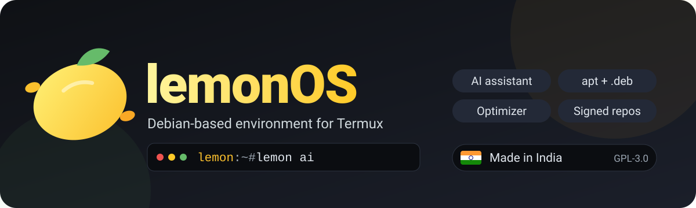

<p align="center">
  
</p>

<p align="center">
  
  
  
  
</p>

**lemonOS** is a Debian environment for Termux (via `proot-distro`) with its own package manager, a built-in AI assistant, and a speed optimizer.

> lemonOS runs on the Android kernel inside proot. It is a full Debian userland with a custom layer on top, not a standalone OS.

## ✨ Features

| | |
|---|---|
| 📦 **`lemon` package manager** | wraps `apt`/`dpkg`, installs local `.deb` files, adds signed third-party repos |
| 🤖 **`lemon ai`** | built-in assistant, asks before running any command |
| ⚡ **`lemon boost`** | parallel downloads, leaner installs, cache cleanup (undo anytime) |
| 🍋 **`lemon brand`** | identifies the system as lemonOS (undo anytime) |
| 🖥️ **`lemon mod`** | one-command mods: XFCE desktop over VNC, dev tools |

## 🚀 Install (in Termux)

```bash
pkg install git -y
git clone https://github.com/themangodeveloper-eng/LemonOS-official.git
cd LemonOS-official
bash install.sh
lemonos            # launch
```

## 🧰 Commands

```text
lemon install|remove|search|info|list|update|upgrade|clean
lemon deb file.deb                    install a local .deb
lemon repo add NAME "URL SUITE COMP" KEY_URL
lemon mod desktop                     XFCE + TigerVNC
lemon ai "how do I ..."               assistant
lemon boost [--undo]                  optimizer
lemon brand [--undo]                  lemonOS identity
```

## 🤖 AI setup

`lemon ai` needs an Anthropic API key (billed separately from the Claude app):

```bash
mkdir -p /etc/lemonos
echo 'ANTHROPIC_API_KEY=sk-ant-...' > /etc/lemonos/ai.conf
chmod 600 /etc/lemonos/ai.conf
```

## ⚡ What boost really does

Parallel apt downloads, no translation files, no recommended packages, faster dpkg I/O, and cache cleanup. Gains are modest; without root there is no kernel tuning.

## 📜 License

lemonOS is free software under the **GNU General Public License v3.0 or later**. See [`LICENSE`](LICENSE).

---

<p align="center">🇮🇳 Made in India</p>

<!-- Optional: delete the next line if you don't want the credit -->
<p align="center"><sub>Built with the help of Claude</sub></p>
